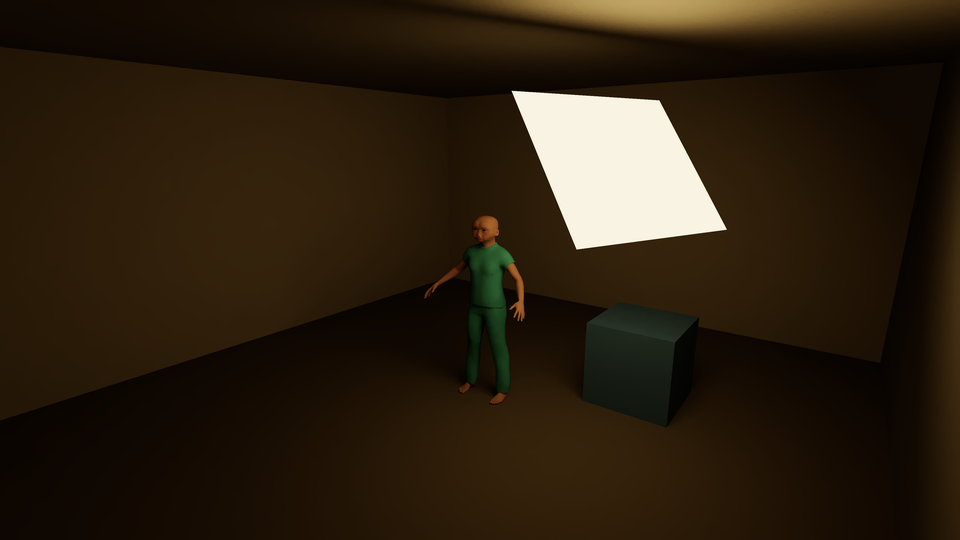

# Scoundrill texture painting

Reusable Zig libraries for rendering and authoring textures on 3D surfaces.
**hamudi-1 is intended to become Scoundrill's default viewport rendering engine.**
The painting libraries serve skin and makeup, building and object textures, and
detailing workflows.

The unchanged Rust TextureCraft build established feasibility. It remains a
pinned behavior reference for a complete Zig recreation of the selected systems,
rather than a runtime dependency of the finished libraries.

Status: a committed 0.1 library release is running and integrated with
Scoundrill's pinned modern viewport factory. It includes COW surfaces, 32 blend
modes, seven recovered brush shapes and image alphas, masks/fills, revisioned
UV/world painting, map baking/import, compact project and PNG IO, raster PBR,
and the recovered progressive tracer/denoiser with HDR lighting.

The real actor paint/cancel/undo/redo workflow, dense 4K project roundtrip,
fixed-topology deformation, room-light controls and native-4K rendering pass.
This is a reusable engine/authoring release; the full upstream tool/preset/format
catalog is not implied. See [delivery, measurements and decisions](docs/DELIVERY.md)
and the explicit [capability inventory](docs/CAPABILITIES.md).

The pure Zig `texture_painting` module has no Vulkan or libc dependency.
`hamudi1` supplies rendering and an optional material-update bridge. Static/shared
C libraries and Python bindings are included; see [API and ownership](docs/API.md).

Build with Zig 0.16.0 and the system Vulkan development loader:

```sh
zig build -Doptimize=ReleaseSafe
zig build test -Dgpu=false
zig build integration
python3 run.py --full --output /tmp/NEW_HAMUDI_ACCEPTANCE
python3 tools/verify_projects.py --output /tmp/NEW_PROJECT_CHECKS.json
./zig-out/bin/hamudi SCENE.json OUT.ppm 256 144 128 gpu
```

The CLI consumes the existing prepared TextureCraft experiment scene and RGBA16
material files. Output is native-resolution PPM with a JSON execution report.
Source shader regeneration uses Python and the locked development-only Naga tool:

```sh
python3 tools/prepare_shaders.py
cargo run --release --locked --manifest-path tools/shader-compiler/Cargo.toml -- "$PWD"
```

- [Product and acceptance brief](docs/BRIEF.md)
- [Library boundaries and upstream inventory](docs/ARCHITECTURE.md)
- [Movie Maker renderer behavior and acceptance map](docs/RENDERER-BEHAVIOR.md)
- [Performance plan](docs/PERFORMANCE.md)
- [Implementation sequence](docs/ROADMAP.md)
- [Reference provenance](docs/PROVENANCE.md)

This is the permanent project checkout. Temporary references and worktrees belong
under /tmp or ~/work-trees and must be removed when their work is finished.

[](reference/acceptance-20261120/warm-reference-4k.png)

The linked image is native 3840×2160; the inline preview is downsampled.
Candidate evidence is separate from all original TextureCraft and BRender goldens.
The full runner uses the sibling Scoundrill fixtures, NVIDIA tooling and a CPU
Vulkan driver in the measured Linux development environment.
